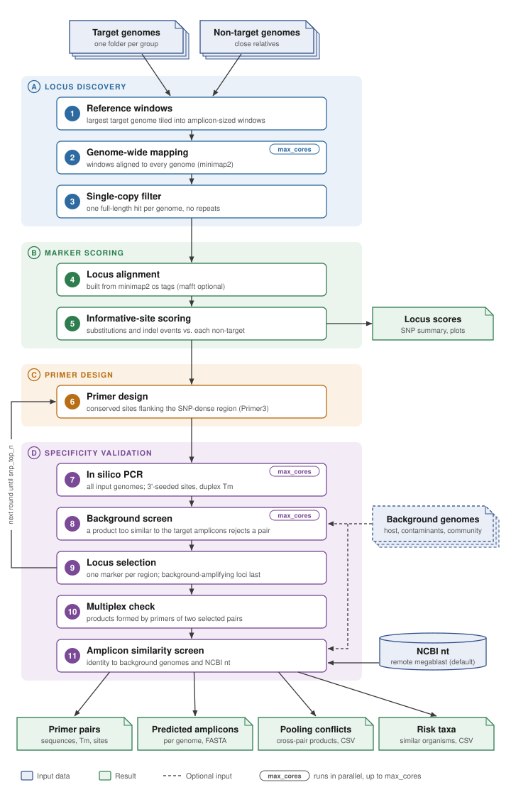
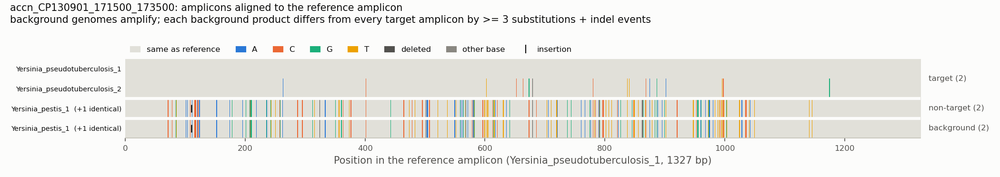

# PRISTINE

Authors: Tomas Kudlacek, Melanie Taprogge, Katharina Hoff

Contact: katharina.hoff@uni-greifswald.de

PRISTINE (PRimer-based Identification Suite Targeting Informative Nucleotide Elements)
designs PCR primer pairs for amplicon-sequencing based identification of a
target group of bacteria (one or several species) against closely related non-target
species. Each primer pair

- binds sites that are identical in every input genome (targets and non-targets),
  so the amplicon is produced from all of them;
- encloses a region that is rich in informative sites (positions where the target
  group differs from each non-target species), so reads of the amplicon tell targets
  and non-targets apart;
- yields exactly one product per genome in silico, and none in optional
  background genomes.

Amplicon sizes of 500-1800 bp are intended for Oxford Nanopore sequencing and for
downstream analysis with [PRISCREEN](https://github.com/AI-Biome/PRISCREEN).

## Installation

Dependencies are managed with [pixi](https://pixi.sh). After installing pixi:

```bash
git clone https://github.com/AI-Biome/PRISTINE.git
cd PRISTINE
pixi install          # creates ./.pixi with python, minimap2, mafft, primer3-py, ...
pixi run pytest       # optional: run the test suite
```

Run the pipeline from the directory that holds your `config.yaml`:

```bash
pixi run --manifest-path /path/to/PRISTINE/pixi.toml pristine --config config.yaml
```

or activate the environment once with `pixi shell` and then call `pristine` directly.

```text
pristine --help
usage: pristine [-h] [-c CONFIG] [-t THREADS] [-o OUTPUT] [--log-level {DEBUG,INFO,WARNING,ERROR}] [--version]
```

`--threads` and `--output` override `max_cores` and `output_dir` from the config.

### Containers

A ready-made image with the locked pixi environment is on Docker Hub as
[`gaiusaugustus/pristine`](https://hub.docker.com/r/gaiusaugustus/pristine). No local
installation is needed. Run it from the directory that holds your `config.yaml`.

With Docker (Linux, macOS, Windows), the project directory is mounted at `/data`, and
`--user` keeps the output files owned by you.

```bash
docker pull gaiusaugustus/pristine:0.3.0
docker run --rm --user "$(id -u):$(id -g)" -e HOME=/tmp \
  -v "$(pwd):/data" gaiusaugustus/pristine:0.3.0 --config config.yaml
```

Apptainer and Singularity (on HPC clusters) mount the current directory
automatically.

```bash
apptainer pull pristine.sif docker://gaiusaugustus/pristine:0.3.0
apptainer run pristine.sif --config config.yaml
```

The image is built for x86-64. On Apple Silicon Macs Docker runs it under emulation,
which is slower but works.

To build the image yourself from the repository root, use
`docker build -t pristine .` or `apptainer build pristine.sif PRISTINE/PRISTINE.def`.

## Quick start with the toy dataset

`PRISTINE/toy_dataset/` contains two *Yersinia pseudotuberculosis* genomes (targets)
and two *Yersinia pestis* genomes (non-targets) plus a ready `config.yaml`:

```bash
cd PRISTINE/toy_dataset
pixi run --manifest-path ../../pixi.toml pristine --config config.yaml

# or, without installing anything, with the container
docker run --rm --user "$(id -u):$(id -g)" -e HOME=/tmp \
  -v "$(pwd):/data" gaiusaugustus/pristine:0.3.0 --config config.yaml
```

With 4 threads this takes about a minute and writes `output/`.

## Input

### Directory layout

One folder per target group, named like the group (for a single species:
`Genus_species`). Target genome files are named `<group>_<i>.fasta`. A `non-targets/`
subfolder holds genomes of closely related species that must be distinguished from
the group. A top-level `non-targets/` folder holds non-targets used for every group.
Non-target species are identified by the file name without the trailing `_<i>`
(`Yersinia_pestis_2.fasta` is species `Yersinia_pestis`). Accepted extensions:
`.fasta .fa .fas .fna`.

```text
input/
├── Yersinia_pseudotuberculosis/
│   ├── Yersinia_pseudotuberculosis_1.fasta
│   ├── Yersinia_pseudotuberculosis_2.fasta
│   └── non-targets/
│       ├── Yersinia_enterocolitica_1.fasta
│       └── Yersinia_pestis_1.fasta
└── non-targets/
    └── Salmonella_enterica_1.fasta
```

Input files are never modified. Genomes may be draft assemblies (several contigs).

### Configuration file

All relative paths are resolved relative to the directory of the config file.

```yaml
input_dir: "data/raw_genomes/"
output_dir: "output/"
max_cores: 8                      # default 1; minimap2 threads, mafft loci at once, and in silico PCR worker processes (Linux)
snp_avg_prop_threshold: 0.005     # default 0.01; loci scoring below this are not copied to informative_loci/

primer3:
  global_params:                  # any Primer3 global tag; values shown are the defaults
    PRIMER_NUM_RETURN: 5          # candidate pairs per locus that are checked in silico
    PRIMER_MIN_SIZE: 18
    PRIMER_OPT_SIZE: 20
    PRIMER_MAX_SIZE: 25
    PRIMER_DNA_CONC: 250.0        # nM primer; every Tm in PRISTINE is computed at this concentration
    PRIMER_MIN_TM: 59.0
    PRIMER_OPT_TM: 62.0
    PRIMER_MAX_TM: 65.0
    PRIMER_PAIR_MAX_DIFF_TM: 3.0
    PRIMER_MIN_GC: 35.0
    PRIMER_MAX_GC: 65.0
    PRIMER_MAX_POLY_X: 4
    PRIMER_PRODUCT_SIZE_RANGE: "500-1800"   # several ranges: "500-1000 1200-1800"

locus_discovery:
  window_size: 2000               # bp; must be >= the largest product size
  step: 500                       # bp between window starts on the reference genome
  minimap2_preset: asm20          # asm5 / asm10 / asm20 (increasing divergence tolerated)
  min_query_coverage: 0.9         # a window must align over >= 90 % of its length
  max_divergence: 0.15            # an alignment more divergent than this does not count as a hit
  max_secondary_coverage: 0.5     # a further hit covering more than this marks the window multi-copy
  max_n_fraction: 0.05            # windows with more Ns than this are not tiled
  max_candidate_loci: 5000        # most divergent (vs non-targets) windows kept for scoring
  require_in_nontargets: true     # false: a locus may be absent from non-target genomes
  refine_with_mafft: false        # re-align loci with mafft before primer design

snp_primer_design:
  snp_window_size: 250            # window scanned for informative-site clusters
  snp_top_n: 5                    # number of loci (one primer pair each) to select
  min_snps: 3                     # informative sites required per non-target species in the amplicon
  max_loci_to_try: 50             # at most this many loci (by rank) go through primer design
  require_snps_for_all_nontargets: true   # false: min_snps for at least one non-target species

primer_selection:
  conservation: all               # "all": primer sites identical in every genome; "targets": only in targets
  use_thermodynamics: true        # score candidate binding sites by duplex Tm (primer3)
  annealing_temp: null            # default PRIMER_MIN_TM - 3
  binding_tm_margin: 5.0          # a site binds if its duplex Tm >= annealing_temp - margin
  near_miss_tm_margin: 5.0        # products whose sites reach only this much less also reject a pair; 0: off
  poolable: true                  # selected pairs form no cross-pair products, so they can be pooled
  max_mismatches: 6               # prefilter: mismatches tolerated over the whole primer
  three_prime_region: 8           # 3'-terminal bases scrutinised separately
  three_prime_max_mismatches: 1   # mismatches tolerated inside the 3' region
  seed_length: 4                  # exact k-mer used to find candidate sites (see step 7)
  max_offtarget_product_size: 4000
  background_dir: null            # folder of FASTA genomes of other organisms in the samples (set this!)
  background_products: distinguish  # or "reject": any background product fails a pair

amplicon_screen:
  background_identity: true       # minimap2 identity of each selected amplicon in every background genome
  remote_blast: true              # megablast the selected amplicons against NCBI nt (network, minutes; false offline)
  blast_db: nt
  megablast: true                 # false: blastn (more sensitive, slower)
  hitlist_size: 100
  entrez_query: null              # e.g. "bacteria[organism]"
  min_identity_report: 90.0       # NCBI hits below this identity are not reported
  fallback_tolerated_identity: 98.0   # lower bound of the tolerated identity (step 11)

make_plots: true
```

`PRIMER_MAX_NS_ACCEPTED` is always 0: the design template is N-masked at every
position that is not identical across the genomes, which is what keeps primers in
conserved sites. Config files of the previous prokka/panaroo based version are still
read; their obsolete keys are ignored with a warning.

## How it works



The figure is generated by `python docs/make_workflow_figure.py`.

The headings below follow the stages (A-D) and step numbers of the figure.

### A. Locus discovery

Genomes are discovered from the directory layout. Steps 1-3 use minimap2 [1].

#### 1. Reference windows

The largest target genome of a group is the reference. It is tiled into overlapping
windows of `window_size` bp, `step` bp apart.

#### 2. Genome-wide mapping

All windows are mapped to every genome, several genomes at a time with up to
`max_cores` threads. Mapping the toy dataset (four 4.7 Mb genomes) takes about 20
seconds with 4 threads.

#### 3. Single-copy filter

A window is kept when, in each genome, it has exactly one alignment covering >=
`min_query_coverage` of the window and no secondary alignment covering more than half
of it. This removes repeats, mobile elements and multi-copy genes, which are a major
source of unexpected PCR products.

### B. Marker scoring

#### 4. Locus alignment

The base-level `cs` strings of the mappings are stacked into one reference-anchored
alignment per locus. No multiple-sequence aligner is run here, so the number of
genomes does not blow up the runtime. Optionally (`refine_with_mafft`), only the few
loci that reach primer design are re-aligned with MAFFT [6], `max_cores` loci at a
time, and re-scored.

#### 5. Informative-site scoring

A column is informative for non-target species S if the bases shown by the target
genomes and the bases shown by S's genomes are disjoint. A run of gap columns is one
indel event. A 1-nt indel inside a homopolymer of 4 or more bases is not counted: it is
the typical nanopore error, so reads cannot be told apart by it. Loci are ranked by the mean proportion of informative sites over
non-target species (and, for groups with several target species, by pairwise
between-species sites).

### C. Primer design

#### 6. Primer design

This step uses Primer3 [2, 3] through primer3-py [14]. The design template is the
alignment consensus with every non-conserved column (and every column touched by an
insertion) masked as N. The densest `snp_window_size` window of informative sites is
passed to Primer3 as `SEQUENCE_TARGET`, so the amplicon must enclose it.

### D. Specificity validation

#### 7. In silico PCR

Every candidate pair is tested against all genomes of the group.
Binding sites are found on both strands in two stages: a NumPy [11] seed scan that finds
every genomic window with at most `three_prime_max_mismatches` mismatches in the
3'-terminal `three_prime_region` bases and at most `max_mismatches` overall. Every
exact `seed_length`-mer of the 3' region is looked up. The config requires
`three_prime_region >= (three_prime_max_mismatches + 1) * seed_length`, so a
mismatch-free seed always exists and no site within these limits is missed, even
with a mismatch at the terminal base. With `use_thermodynamics`, the 5' part is also
compared at a shift of one base so template bulges are not missed, and Primer3's
thermodynamic heterodimer calculation, based on nearest-neighbour parameters
[4, 5], gives the duplex Tm of the primer on that genomic window. A site binds if
the Tm is at least `annealing_temp - binding_tm_margin` (51 C by default); without
thermodynamics the mismatch limits alone decide.

All Tm values (primer3's primer Tm, the duplex Tm of binding sites and the default
annealing temperature) are computed at `PRIMER_DNA_CONC`, 250 nM by default. Primer3's
own default of 50 nM is below the 200-500 nM of a typical PCR and gives Tm values about
2 C too low. Set it to the primer concentration of your reaction. The default Tm range
of 59-65 C at 250 nM selects the same primers as 57-63 C at 50 nM.

A product whose weaker site reaches only `binding_tm_margin + near_miss_tm_margin`
below the annealing temperature (46-51 C by default) is a near miss. Once a first copy
of it exists, later cycles prime on the perfect primer sequence it carries, so such a
product can appear in the lab. A near miss in any input or background genome therefore
rejects the pair, whatever its sequence (`... near-miss product(s) ...` in
`Failure_Reasons`), and the multiplex check counts near misses as cross-pair products.
Finding them costs almost nothing: they come from the same candidate sites and duplex
Tm values. All products up to
`max_offtarget_product_size` from any primer combination (including F/F and R/R)
are enumerated. A pair is accepted only if

- no genome gives a product outside the locus,
- every genome that carries the locus gives exactly one product there (with
  `conservation: targets`, non-target genomes may give none),
- every product at the locus is between 90 % of the smallest and 110 % of the
  largest `PRIMER_PRODUCT_SIZE_RANGE` bound (alignment and real sizes differ by
  indels), and
- the amplicon contains at least `min_snps` informative sites for each non-target
  species (for at least one with `require_snps_for_all_nontargets: false`).

With `require_in_nontargets: false`, a non-target genome that lacks the locus must
give no product at all; its absence already tells it apart.

This step dominates the runtime. A pair that fails the informative-site criterion
is not amplified at all, since that check needs no PCR. The duplex Tm is computed
only for candidate sites that have a possible partner site on the other strand
within `max_offtarget_product_size`, and it is cached because related genomes repeat
the same binding sites; neither shortcut changes the products. On Linux the step
runs in `max_cores` worker processes, one candidate pair per worker, sharing genome
k-mer indexes that are built once. Primer3 is run on a few loci at a time so that
every worker has a pair, and the results are taken in rank order, so the output does
not depend on `max_cores`. The background screen splits the pairs still passing over
the workers in the same way. On macOS the step runs on one core.

#### 8. Background screen

All pairs that survived step 7 are screened in one streaming pass over the genomes in
`background_dir` (loaded one file at a time, so hundreds of genomes are fine). Because
the amplicon is sequenced, a background organism may amplify as long as its product
can be told apart from the target: with `background_products: distinguish` (the
default), a product that differs from every target amplicon by fewer than `min_snps`
substitutions + indel events (again without 1-nt indels in homopolymers of 4 or more)
rejects the pair, and any other product is recorded in
the `Background_Products` column. A near miss rejects the pair in both modes. Products sharing less than half their 15-mers with
every target amplicon count as different without an alignment; the others are aligned
globally (Biopython). With `background_products: reject`, any background product
rejects the pair.

#### 9. Locus selection

The best surviving pair per locus is selected in rank order, one locus per genomic
region (amplicons on the reference must not overlap). Pairs without any background
product are preferred: a locus whose passing pairs all amplify in the background is
kept in reserve, and reserve loci are selected (marked as fallback in
`locus_design_log.csv`) only after `max_loci_to_try` loci have been tried with fewer
than `snp_top_n` loci selected. Steps 6-9 run in rounds (the loop arrow in the
figure): each round designs loci until it has twice as many passing regions as are
still missing (as many without a background), so the background screen can reject
some. If fewer than `snp_top_n` loci are selected, the next round continues with the
next-ranked loci, until `snp_top_n` loci are selected or `max_loci_to_try` loci have
been tried (a warning reports a shortfall). Without `background_dir` the pipeline
warns loudly: the screen then knows nothing beyond your input genomes.

#### 10. Multiplex check

The selected pairs are checked for pooling in one reaction: in silico PCR with primers
of two different pairs combined, on every genome of the group, with near misses
counted as products. With `poolable: true` (the default) this check runs during
locus selection: a locus whose pair forms a product with an already selected pair
is skipped (`skipped: primers form cross-pair products with selected locus ...` in
`locus_design_log.csv`), so the final pairs can always be pooled and
`primers/multiplex_check.csv` stays empty. With `poolable: false` such loci are
selected, the products are listed in `primers/multiplex_check.csv`, and each pair of
loci that forms one is reported with a warning not to pool them. This check uses the
group's own genomes only, not the background genomes.

#### 11. Amplicon similarity screen

Primer screening asks *what amplifies*; this step asks *who else carries this marker*.
For every selected locus the reference amplicon is (a) mapped to each background
genome with minimap2 and (b), unless `remote_blast: false`, megablasted [7, 8] against
NCBI nt [9] through NCBI's web service, submitted and parsed with Biopython [10]. Each
hit is labelled target, known non-target or unknown taxon by its organism name. An
unknown organism whose identity to the amplicon is at least the *tolerated identity*
(100 % minus the fraction of informative sites separating the target from its nearest
designed non-target, but at least `fallback_tolerated_identity`), over at least half
of the amplicon, is a false-positive risk and is reported with a warning: add it as a
non-target or background genome and rerun. Background genomes are flagged by the same
rule. This flag differs from the background screen in step 8: it asks whether a
background genome carries a sequence as close to the amplicon as the nearest
non-target, whether or not the primers amplify it, while step 8 asks whether an actual
background product could be mistaken for the target (fewer than `min_snps`
differences). A selected locus can therefore pass step 8 and still be flagged here. A
failed NCBI request is logged and recorded in the summary (`BLAST_Error`); it does not
stop the run.

## Output

```text
output/
├── run_summary.csv                      one row per group
├── priscreen_panel.fasta                panels of all groups merged (for PRISCREEN)
├── pristine.log
└── <group>/
    ├── locus_discovery/                 reference_windows.fasta, <genome>.paf (+ .paf.log) per genome
    ├── loci/
    │   ├── locus_table.csv              locus -> coordinates in every genome
    │   ├── aligned/<locus>.fasta        reference-anchored alignments of all candidate loci
    │   └── mafft/                       re-aligned loci (refine_with_mafft only)
    ├── informative_loci/
    │   ├── snp_summary.csv              scores and informative positions per locus (see below)
    │   ├── heatmap_informativeness.png
    │   ├── <locus>.fasta                alignments passing snp_avg_prop_threshold
    │   ├── consensus_sequences/         <locus>.fasta (IUPAC consensus), <locus>.masked_template.fasta
    │   └── snp_density_plots/           snp_positions_<locus>.png for selected loci
    └── primers/
        ├── selected_primers.csv         the accepted primer pair per locus, best first  <-- main result
        ├── selected_primers.fasta       the same primers, best first (rank<N>_<locus>_LEFT/RIGHT)
        ├── primer_design_summary.csv    every candidate pair with pass/fail reasons (selected pairs first)
        ├── locus_design_log.csv         per locus: target region and outcome
        ├── multiplex_check.csv          products formed by primers of two different selected pairs (pooling)
        ├── <locus>_primers.fasta        LEFT/RIGHT sequences of accepted pairs
        ├── amplicons/<locus>_amplicons.fasta  predicted amplicon of every genome, locus orientation
        ├── priscreen_panel.fasta        distinct amplicons per locus and species, incl. background products (PRISCREEN)
        ├── diagnostic_sites/<locus>.tsv positions where the species' amplicons differ (substitutions, indels)
        ├── amplicon_alignments/<locus>.png  loci that amplify in the background: every amplicon aligned to the reference amplicon, differences coloured by base (+ <locus>_differences.tsv)
        └── amplicon_screen/
            ├── amplicon_screen_summary.csv  per locus: tolerated identity, closest background genome, risk taxa
            ├── background_identity.csv      amplicon vs. background genome identities
            ├── blast_hits.csv               NCBI hits with organism, identity, status (remote_blast only)
            ├── blast_results.xml            raw NCBI BLAST XML (remote_blast only)
            └── reference_amplicons.fasta    query sequences, ready for manual Primer-BLAST / BLAST
```

Locus names are `<contig>_<start>_<end>` on the reference genome.

`run_summary.csv` gives, per group, the reference genome, the numbers of genomes,
background genomes, candidate, scored, tried and designed loci, the number of selected
primer sets and the runtime, or an `Error` column if the group failed (the exit code
is then 1). The plots are skipped with `make_plots: false`.

`locus_design_log.csv` has one row per locus that went through primer design: score,
conserved fraction of the template, `Target_Start`/`Target_Length` (the
`SEQUENCE_TARGET`) and `Outcome`, e.g. `selected pair 0`, `primer3 found no pair (...)`,
`all passing pair(s) rejected by the background screen` or
`skipped: amplicon overlaps selected locus ...`.

`snp_summary.csv` columns: `Combined_Informativeness_Score` (ranking),
`Avg_Prop_Informative_SNPs_External`/`_Internal`, and per non-target species `S`:
`Prop_External_S`, `Abs_External_S` (substitutions + indel events),
`Subst_External_S`, `Indel_External_S`, `Weak_Indel_External_S` (1-nt indels in
homopolymers of 4 or more, not counted), `SNP_Pos_External_S` (alignment columns) and
`Core_Region_External_S`. Groups with several target species get the same columns as
`..._Internal_<A>_vs_<B>`.

The selected pairs are ranked, best first, in `selected_primers.csv`,
`selected_primers.fasta`, `primer_design_summary.csv` (column `Rank`, 1 = best; empty
for pairs that were not selected), `priscreen_panel.fasta` and the amplicon screen.
Ranking: pairs without background products before fallback pairs that amplify in the
background, then the higher `Locus_Combined_Score` (informative sites against the
non-targets), then the lower `Primer3_Penalty`. If you need fewer primer sets than
were selected, take them from the top. In `primer_design_summary.csv` the selected
pairs are followed by the other passing pairs and then the failed ones, each sorted
the same way.

`selected_primers.csv` / `primer_design_summary.csv` columns include `Rank`, the primer
sequences, Tm and GC, `Template_Product_Size` (on the alignment, including insertion
columns of other genomes), `On_Target_Product_Sizes` (real predicted size per genome),
`Sites_In_Amplicon_External_S`, `Min_On_Target_Site_Tm` (weakest predicted primer
duplex among the intended sites), `Background_Products`,
`Recommended_Annealing_Temp` and `Failure_Reasons` for rejected pairs.
`Recommended_Annealing_Temp` is 3 C below the Tm of the pair's weaker primer, and never
below the annealing temperature the in silico PCR assumed. Annealing lower than that
lets more mismatched sites bind than were screened for.

`amplicon_alignments/<locus>.png` is drawn for every selected locus that also amplifies
in a background genome. Each row is one predicted amplicon (identical ones collapsed)
aligned to the reference amplicon; grey is the reference base, coloured bars are
differences. The example below comes from the toy data run with the two
*Yersinia pestis* genomes given as background as well, so the non-target and
background rows coincide. In a real run the background rows show how far each
background product is from the targets; `<locus>_differences.tsv` lists every
difference.



`priscreen_panel.fasta` is the reference panel for classifying the sequenced reads with
[PRISCREEN](https://github.com/AI-Biome/PRISCREEN). Each record is one distinct amplicon
of a (locus, species), headed `>locus|species=...|genome=...|role=target|non-target|background`,
in the orientation of the reference amplicon. Background products of fallback loci are
included with the background genome's species, so their reads are named, not mistaken
for the closest non-target. In the run-level file, a locus name used by two groups gets
the group name as prefix.

`diagnostic_sites/<locus>.tsv` lists, on the reference amplicon, every position where two
species share no base: `position` (1-based; for an insertion, the base after which it
lies), `type` (`substitution` or `indel`; an indel event is one row whatever its
length), `length`, `ref`, `homopolymer_base` and `homopolymer_length` (1-nt indels in
long homopolymers are the typical nanopore error), `weak` (`yes` for a 1-nt indel in a
homopolymer of 4 or more: not counted), `separates_target_from` (species that
share no state with any target genome) and one column per species with its base,
inserted bases or `-` (several states joined by `/`). The rows with `weak` = `no` naming a
species in `separates_target_from` are the sites counted in `Sites_In_Amplicon_External_S`.

## When too few or no markers are found

A group that has no single-copy locus shared by all required genomes fails: its row
in `run_summary.csv` has an `Error`, the other groups still run, and the exit code
is 1. Otherwise the run finishes with exit code 0 even if fewer than `snp_top_n`
loci (or none) were selected; the log then warns
`only <n> of snp_top_n=<N> loci selected after trying <m> locus/loci`, and
`selected_primers.csv` has no rows. Before that point, loci whose primer
pairs amplify in a background genome are added as a fallback (step 9).

The reason is in `primers/locus_design_log.csv` (`Outcome`, one row per locus) and in
`primer_design_summary.csv` (`Failure_Reasons`, one row per primer pair). What to
change depends on the outcome:

| Outcome or failure reason | Meaning | Settings to try |
| --- | --- | --- |
| Group fails with `No single-copy loci shared by the required genomes were found` | No window maps once, over its full length, to every genome | lower `min_query_coverage`, raise `max_divergence`, `require_in_nontargets: false`, check the inputs for very fragmented assemblies |
| `no window of ... bp with >= ... informative sites` | Targets and non-targets are too similar at this locus | lower `min_snps`, larger `snp_window_size`, `require_snps_for_all_nontargets: false` |
| `primer3 found no pair (...)` | Too few conserved positions next to the informative sites | `conservation: targets`, a wider `PRIMER_PRODUCT_SIZE_RANGE`, a wider Tm or size range |
| `amplicon has < ... informative sites` | The amplicon misses the informative sites of some non-target | as for `no window ...` above |
| `<genome>: ... off-target product(s)`, `... products at locus` | Primers bind elsewhere in an input genome | raise `PRIMER_NUM_RETURN` so more pairs per locus are tested, raise `max_loci_to_try` |
| `background ...: ... product(s), only ... difference(s)` | A background product looks too much like the target amplicon | move that organism to the non-targets if it must be told apart, or keep it and accept fewer loci |

Raising `max_loci_to_try` (default 50) is always worth a try: loci are designed in
rank order, and lower-ranked loci often still have enough informative sites. If
almost no locus reaches `min_snps`, the target group may not be separable from a
non-target species with single-copy amplicons of this size at all; the
`Abs_External_<species>` columns of `snp_summary.csv` show how many sites separate
them at the best loci.

## Notes on specificity

Primers with Tm around 62 C, no ambiguous bases, and a single predicted product in
every input genome are necessary but not sufficient for a clean PCR: the in silico
check only knows the genomes you provide. Add genomes of organisms expected in your
samples (host, common contaminants, other community members, e.g. the taxa seen in
16S profiles of the same samples) to `background_dir`, or as non-targets if they
should also be discriminated by the amplicon. For a final shortlist, Primer-BLAST
against NCBI nt remains the broadest available screen. The thermodynamic binding model
is a prediction: a reported duplex Tm just above the threshold means that a weak
product is possible. Sites just below the threshold are rejected as near misses, but
annealing below the screened temperature lets weaker sites bind than were checked.

## Development

```bash
pixi run test                  # pytest on synthetic genomes (uses minimap2, mafft, primer3)
```

The code lives in `src/pristine/`: `config` (YAML loading and validation), `manifest`
(input discovery), `loci` (windows, minimap2), `pseudoalign` (alignments from cs
tags), `alignment` (optional mafft refinement), `scoring`, `consensus`, `primers`
(primer3), `insilico_pcr`, `blast` (amplicon screen), `plots`, `seqio`, `pipeline`,
`cli`. The tests run fully offline (`remote_blast: false`).

## License

PRISTINE is distributed under the Artistic License 2.0 (see [LICENSE](LICENSE)).

## References

If you use PRISTINE, please also cite the tools it builds on.

1. Li H. (2018). Minimap2: pairwise alignment for nucleotide sequences. *Bioinformatics* 34(18):3094-3100. <https://doi.org/10.1093/bioinformatics/bty191>
2. Untergasser A. et al. (2012). Primer3: new capabilities and interfaces. *Nucleic Acids Research* 40(15):e115. <https://doi.org/10.1093/nar/gks596>
3. Koressaar T., Remm M. (2007). Enhancements and modifications of primer design program Primer3. *Bioinformatics* 23(10):1289-1291. <https://doi.org/10.1093/bioinformatics/btm091>
4. SantaLucia J. Jr. (1998). A unified view of polymer, dumbbell, and oligonucleotide DNA nearest-neighbor thermodynamics. *PNAS* 95(4):1460-1465. <https://doi.org/10.1073/pnas.95.4.1460>
5. SantaLucia J. Jr., Hicks D. (2004). The thermodynamics of DNA structural motifs. *Annual Review of Biophysics and Biomolecular Structure* 33:415-440. <https://doi.org/10.1146/annurev.biophys.32.110601.141800>
6. Katoh K., Standley D.M. (2013). MAFFT multiple sequence alignment software version 7: improvements in performance and usability. *Molecular Biology and Evolution* 30(4):772-780. <https://doi.org/10.1093/molbev/mst010>
7. Camacho C. et al. (2009). BLAST+: architecture and applications. *BMC Bioinformatics* 10:421. <https://doi.org/10.1186/1471-2105-10-421>
8. Zhang Z., Schwartz S., Wagner L., Miller W. (2000). A greedy algorithm for aligning DNA sequences. *Journal of Computational Biology* 7(1-2):203-214. <https://doi.org/10.1089/10665270050081478>
9. Sayers E.W. et al. (2026). Database resources of the National Center for Biotechnology Information in 2026. *Nucleic Acids Research* 54(D1):D20-D27. <https://doi.org/10.1093/nar/gkaf1060>
10. Cock P.J.A. et al. (2009). Biopython: freely available Python tools for computational molecular biology and bioinformatics. *Bioinformatics* 25(11):1422-1423. <https://doi.org/10.1093/bioinformatics/btp163>
11. Harris C.R. et al. (2020). Array programming with NumPy. *Nature* 585(7825):357-362. <https://doi.org/10.1038/s41586-020-2649-2>
12. McKinney W. (2010). Data Structures for Statistical Computing in Python. *Proceedings of the 9th Python in Science Conference (SciPy 2010)*. <https://doi.org/10.25080/Majora-92bf1922-00a>
13. Hunter J.D. (2007). Matplotlib: A 2D Graphics Environment. *Computing in Science & Engineering* 9(3):90-95. <https://doi.org/10.1109/MCSE.2007.55>
14. primer3-py: Python bindings for Primer3. <https://github.com/libnano/primer3-py>

Tables are written with pandas [12] and plots drawn with matplotlib [13]. The environment
is managed with [pixi](https://pixi.sh); containers use [Docker](https://www.docker.com)
or [Apptainer](https://apptainer.org).
